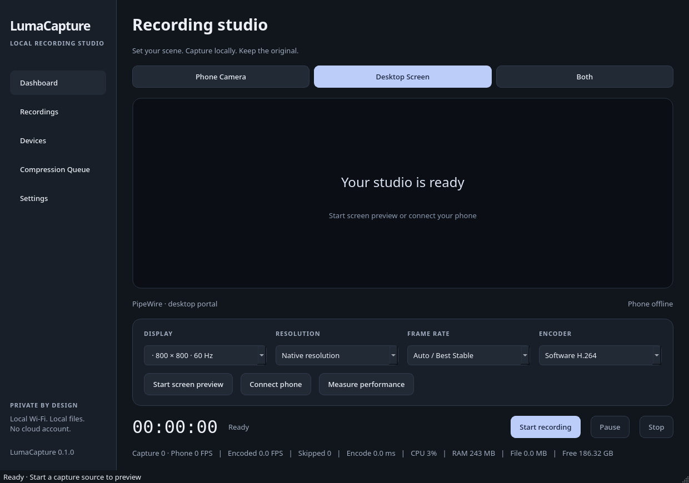

# LumaCapture

LumaCapture is a local desktop and phone camera recording studio. It receives browser camera video over encrypted WebRTC, captures desktop video through native platform APIs, records to recoverable MKV files, and creates validated MP4 exports.

**Development status:** working implementation under verification, not a production release. See [verification](docs/VERIFICATION.md) for executed tests and release blockers. Windows and physical phone compatibility must not be inferred from Linux or synthetic transport tests.



The screenshot is from the running application. The empty preview is intentional: no recording or device data is fabricated.

## Features

- Phone Camera, Desktop Screen, and Both modes.
- Picture-in-picture with corner placement, size, opacity, mirroring, rounded corners, and borders.
- Separate screen and camera MKV files sharing one recording clock.
- Start, pause, resume, stop, free-space monitoring, and interrupted-file recovery.
- Local HTTPS pairing with one-use, two-minute QR codes and encrypted WebRTC media.
- Front/rear mobile camera selection, requested resolutions and frame rates, reconnect attempts, and visible camera/recording indicators.
- SQLite recording library with actual file metadata, thumbnails, playback, rename, export, and deletion.
- Persistent compression queue with H.264, HEVC, and AV1 options, cancellation, quality controls, and output validation.
- Dark and light desktop themes with an opaque fallback surface.

## Platform targets

| Platform | Capture implementation | Verification |
|---|---|---|
| Windows 10/11 x64 | Windows Graphics Capture via `windows-capture`, Qt DXGI fallback | See verification report |
| Linux x86_64 / X11 | Qt Multimedia X11 capture | See verification report |
| Linux / Wayland, including Hyprland | Qt PipeWire capture through xdg-desktop-portal | Requires a working ScreenCast portal and permission |
| Android Chrome | HTTPS `getUserMedia` → WebRTC | Physical device testing pending |
| iPhone Safari | HTTPS `getUserMedia` → WebRTC | Physical device testing pending; manual certificate trust required |

Qt documents its Wayland screen capture as experimental. The target display is selected in the system portal; the desktop monitor dropdown does not override that selection. [Qt documentation](https://doc.qt.io/qt-6/qscreencapture.html)

## Installation

There is no production release until the [release gates](docs/release-verification.json) pass. GitHub Actions builds platform-specific candidate artifacts. Download only artifacts from a successful run for the commit you intend to test.

### Windows

Extract `LumaCapture-Windows-x64.zip` and launch `LumaCapture/LumaCapture.exe`. Keep the `_internal` directory beside the executable. The portable bundle includes Python, Qt, media libraries, and runtime dependencies. It is unsigned; there is no installer or automatic firewall modification. Remove the extracted directory to uninstall. Application data and recordings remain in your user directories until you remove them explicitly.

### Linux

Extract `LumaCapture-Linux-x86_64.tar.gz`, then run `./LumaCapture/LumaCapture`. The CI package targets Ubuntu 24.04 or newer compatible systems. The host must provide its graphics drivers, X11 or Wayland libraries, audio service, PipeWire, and a suitable desktop portal. For the AppImage, make `LumaCapture-Linux-x86_64.AppImage` executable and run it. If FUSE is unavailable, use `./LumaCapture-Linux-x86_64.AppImage --appimage-extract-and-run`. It has the same host-library baseline as the portable package; see the verification report for tested builds. The portable package includes a desktop entry; adjust its `Exec` and `Icon` paths before installing it in `~/.local/share/applications/`.

For Hyprland, use a working `xdg-desktop-portal-hyprland` or another ScreenCast portal appropriate for your compositor. LumaCapture does not change portal configuration or bypass permission dialogs.

## First-time setup

1. Launch the desktop app. Settings shows the recording directory, normally `~/Videos/LumaCapture`.
2. Select the recording mode on Dashboard.
3. For a screen source, click **Start screen preview**. Approve and select a source in the Wayland portal when prompted.
4. For a phone source, open **Devices**, choose the desktop's Wi-Fi address, and start the phone server.
5. Complete certificate trust on the phone, scan a new pairing QR, and tap **Connect camera**.
6. Confirm the preview, select output settings, and start recording from the desktop.

## Android and iPhone connection

The desktop serves the mobile page locally. There is no phone app, external signaling service, account, or cloud upload. The phone transmits media and never uses MediaRecorder or creates persistent video files.

Both devices must be on the same local network. Use Android Chrome or iPhone Safari, grant camera permission, and optionally enable the phone microphone. Requested camera settings are preferences; the mobile page displays the actual negotiated resolution and frame rate. Camera switching reacquires the hardware and renegotiates the connection.

### HTTPS and trust

**An HTTP page at a local IP address cannot be assumed to have camera access. A self-signed certificate is not automatically trusted on iPhone.**

LumaCapture creates a unique local CA and an IP-address certificate on your desktop. In Devices, open **Certificate setup instructions**. Transfer the public certificate by USB, or temporarily enable the certificate download page. The HTTP download page serves only the public certificate and instructions for ten minutes. It cannot authenticate itself. Compare the downloaded certificate's SHA-256 fingerprint with the value on the desktop before installing it; prefer USB transfer if your phone cannot inspect that fingerprint.

Installing a root CA grants it authority to authenticate websites on your phone. Install only your own desktop's CA. Keep its private key protected and remove its trust when it is no longer needed. LumaCapture never installs trust silently.

- **Android:** install `LumaCapture-Root-CA.crt` as a CA certificate in Settings → Security / Encryption & credentials. Menu names vary by device. Review the Android warning.
- **iPhone:** download the provided certificate profile; inspect and install it under Settings → General → VPN & Device Management. Then enable full trust under General → About → Certificate Trust Settings. Installing the profile alone is insufficient. [Apple instructions](https://support.apple.com/en-us/102390)
- Reopen a fresh **HTTPS** pairing QR after trust is installed. Do not bypass a remaining certificate warning.

A zero-install, first-scan offline camera experience cannot be guaranteed without prior trusted-certificate provisioning. If your device policy prevents installing trust, this offline browser workflow is unavailable on that device.

The QR carries a 256-bit secret in its URL fragment, which is removed by the page and exchanged once over HTTPS. It expires in two minutes. The resulting in-memory session can reconnect for up to 12 hours; refreshing the page requires a new pairing code. Disconnect from either device to revoke it.

## Offline Wi-Fi and hotspots

Recording does not contact GitHub or any external server. Both a router without internet and a phone/desktop hotspot can work if they permit client-to-client traffic. LumaCapture discovers active private IPv4 interfaces instead of assuming a gateway address. Select the address reachable from your phone.

Allow TCP 8443 for HTTPS and local UDP for WebRTC. TCP 8444 serves public certificate setup only when enabled. Firewall rules are not changed automatically. No STUN or TURN service is configured. IPv6-only networks and restrictive client-isolated hotspots are not supported by this build.

If the selected address disappears, LumaCapture stops the server and asks you to select the new address. Start it again and scan a fresh QR. The existing CA remains, while a new IP certificate is issued. The phone attempts bounded reconnections while its page stays open. Locking the screen or putting Safari/Chrome in the background may suspend streaming. Wake lock is requested where supported, but uninterrupted background capture is not promised.

## Recording

### Desktop Screen

Select a monitor on X11 or Windows, or use the Wayland portal chooser. Native output dimensions come from received capture frames, not the display's logical UI geometry. Custom output may reduce resolution; upscaling is rejected. Cursor inclusion is selectable for WGC; other backends use platform or portal policy.

30 and 60 FPS can be requested. **Measure performance** exercises conversion, composition, and encoding on captured content. Auto runs this measurement before recording and selects 15, 30, 60, or 120 FPS with measured encoding headroom; 120 FPS is offered only after sufficient measured capacity. This is a short estimate, not a sustained-performance guarantee, and a high-refresh display alone is not proof of achievable recording FPS. Actual capture-event FPS, encoded FPS, skipped output frames, encode latency, process CPU, memory, file size, and free space are displayed. Unchanged desktop content may produce no new capture events.

### Phone Camera

Connect the camera and wait for live preview before starting. The desktop writes the received video. Stop and Disconnect are separate: stopping a recording leaves camera preview active until you disconnect.

### Both

Choose Picture-in-picture or Separate synchronized files in Settings before starting. Separate outputs share start time, pause intervals, frame timestamps, and a session ID. They contain the same selected mixed audio. Camera placement, opacity, border, mirroring, and rounded corners are configured in Settings. Settings are snapshotted when recording starts.

Choose a phone-disconnection policy: hide/black, freeze the last frame, pause, or stop and save. Paused recordings require an explicit Resume. Disconnection does not delete screen data.

### Audio

Enable the phone microphone on the mobile page and Phone audio in desktop Settings to record it. Select a desktop microphone if needed. Independent gain controls mix stereo audio with clipping protection. System audio uses WASAPI loopback on Windows and an exposed monitor/loopback input on Linux. Select that input explicitly. Windows speaker capture uses WASAPI loopback through PyAudioWPatch; hardware verification is pending.

Sources are normalized onto a monotonic desktop timeline with a 120 ms playout delay. This is receive-time alignment with bounded jitter buffering, not calibrated cross-device clock synchronization. Physical phone lip-sync and long-duration drift require real-device validation; see known limitations.

### Reliability and recovery

Recordings are written to `.partial.mkv` with short clusters. Stop flushes encoders, decodes and validates the streams, syncs the file, and promotes it without replacing an existing recording. Final validation may take time on long recordings; the UI stays available. A low-space check stops recording before disk exhaustion when possible.

At startup, decodable interrupted MKV files are remuxed into new `.recovered.mkv` files and indexed. Original fragments are retained even if recovery fails. Do not delete the only valid copy. Sudden power loss can still lose buffered data or damage the last cluster.

## Compression and Telegram exports

Automatic compression is enabled by default and configurable in Settings. **Fast** uses H.264 with a fast encoder preset; **Balanced** uses moderate quality and effort; **Maximum Compression** uses slower H.264 and higher CRF. These names describe tradeoffs, not guaranteed file sizes.

**Compress again** opens advanced settings: H.264, HEVC, AV1 (SVT or AOM), CRF, speed, downscaling, FPS reduction, audio bitrate, and an optional size target. H.264 MP4 is the compatibility preset. HEVC and AV1 require available encoders and compatible playback software; AV1 is not universally smaller or faster. Target size uses a single-pass bitrate estimate, so it can fail to meet a tight limit. Oversized output is not marked complete. Quality-mode size cannot be accurately predicted before encoding.

The **Telegram** preset exports H.264 MP4 at up to 1280 pixels wide and 30 FPS with 96 kbit/s audio. It does not send anything to Telegram or guarantee compliance with changing service limits. Select an appropriate target size yourself if needed.

The queue persists across restarts. In-progress jobs become Interrupted and can be retried. Cancellation retains the original and any partial output. A completed export must decode, contain the expected audio/video streams, and match duration and dimensions. Originals are never automatically removed in this build. **Export** copies an existing file; it does not transcode it.

## Hardware acceleration and performance

Encoder discovery actually opens and encodes frames with NVENC, Quick Sync, AMF, and software H.264. A codec listed by FFmpeg alone is insufficient. Failed hardware initialization falls back to software before recording begins. Driver or runtime failures during recording preserve partial media and report an error.

Capture, WebRTC, encoding, and compression run in separate execution paths with bounded receive buffers. The current compositor uses CPU RGB frames and copies; this is not a zero-copy pipeline. High-resolution/high-FPS combined capture can exceed ordinary laptop capacity. A four-second overload window reduces encoding cadence, reports the change, and preserves resolution and timing. Reduce output size or FPS when skipped frames continue to rise. The metrics tooltip reports system memory pressure and GPU utilization when NVIDIA NVML or Linux AMD sysfs provides it; unsupported drivers show unavailable. These GPU interfaces require hardware verification. Compression pauses while recording or finalizing to reduce resource contention.

## Troubleshooting

| Symptom | Checks |
|---|---|
| Camera permission unavailable | Trusted HTTPS is required; verify IP certificate, phone clock, and root CA trust. |
| iPhone still warns after profile installation | Enable full trust under Certificate Trust Settings. |
| Phone cannot open the page | Confirm selected IPv4 address, same network, TCP firewall rule, and hotspot isolation. |
| Page opens but video never connects | Allow local WebRTC UDP; no TURN relay is available to bypass blocked LAN traffic. |
| Wayland preview never appears | Verify PipeWire and the correct ScreenCast portal; check the system permission dialog and portal logs. |
| Windows capture fails | Select DXGI fallback in Settings; protected content and secure desktops cannot be recorded. |
| Audio is silent | Check both phone and desktop audio toggles, selected input device, and OS microphone permission. |
| Recording stops or drops frames | Inspect the error, disk space, encode latency, thermal load, and output resolution/FPS. |
| Interrupted recording | Keep `.partial.mkv`; relaunch to attempt recovery. |
| Compression fails | Read queue Details; original media is retained. Try H.264 or a less restrictive target. |

## Build from source

Use Python 3.12 or newer, 64-bit, and a supported OS. Native Qt and FFmpeg functionality comes from pinned wheel dependencies. A C++ compiler is not needed for the normal wheel-based build.

```sh
python -m venv .venv
# Linux
source .venv/bin/activate
# Windows PowerShell instead: .venv\Scripts\Activate.ps1
python -m pip install -e ".[dev]"
python -m lumacapture.app
```

Build and verify a portable bundle **on each target OS**:

```sh
python -m pytest -q
python -m ruff check src tests tools
python tools/package.py
# Linux only, after the portable build:
python tools/package_appimage.py
```

`--smoke-test` opens the actual UI, writes and validates a one-second video, and exits. `--capture-test DIRECTORY` requests genuine desktop capture, records five seconds, validates the saved file, and exits. The latter needs a usable desktop and Wayland permission. FFprobe is used by the test suite when installed. Synthetic source tests exercise media mechanics and WebRTC transport; they do not certify physical cameras or operating systems.

## Architecture

The repository uses a Python application layer with Qt 6 native capture and UI, PyAV/FFmpeg media libraries, aiortc transport, and SQLite. This avoids a separate signaling daemon and keeps one media clock and storage model. It deliberately differs from the suggested C++/QML layout; see [architecture](docs/ARCHITECTURE.md) for tradeoffs.

```text
src/lumacapture/
  capture/       Native desktop and audio adapters
  media/         Buffers, clocks, compositor, codec probing, media validation
  recording/     State machine integration, muxing, finalization, recovery
  compression/   Persistent export queue and transcoding
  networking/    Local interfaces, HTTPS signaling, WebRTC receiver
  security/      Pairing tokens, rate limits, local certificate identity
  storage/       SQLite library and settings
  ui/            Native Qt desktop interface
  web/           Offline mobile camera and certificate setup pages
packaging/       Native portable bundle definitions
.github/workflows/  Separate Windows/Linux builds and gated publication
```

## Privacy and security

No analytics, cloud uploads, external signaling, or embedded credentials are included. The camera server starts only when requested and binds one selected private IPv4 address. Pairing secrets are not included in server access logs. Session credentials remain in browser memory. The server validates request origins, host headers, content type, size, session authorization, and local ICE candidates. It limits pairing/signaling requests and accepts one paired phone. QR codes are bearer credentials: do not share them.

The public certificate setup endpoint is separate from camera/signaling endpoints. CA private keys stay in the user application-data directory with restrictive Unix permissions; Windows relies on the user profile's ACL. Local users with access to your account or a compromised desktop can access your media and keys. Root trust must be removed manually on the phone when decommissioning the desktop. See [security](SECURITY.md).

## Known limitations

See [verification](docs/VERIFICATION.md) for the current blockers. In particular: physical Android/iPhone trust and streaming, Windows 10/11 display and audio capture, offline hotspot operation, and sustained A/V synchronization require real hardware verification. Windows Server CI capture does not certify Windows client hardware. Zero-copy composition and IPv6-only pairing are not implemented. Windows 11 system backdrop integration uses the supported DWM API where available; Linux and unsupported Windows versions use opaque surfaces. GPU metrics depend on driver interfaces. AppImage extraction and execution are tested; FUSE mounting and clean-machine portability still require validation. No production compatibility or performance guarantee is made for these gaps.

## License and contributions

LumaCapture is licensed under GPL-3.0-or-later. Qt, FFmpeg, codecs, and other dependencies retain their own licenses. See [third-party notices](THIRD_PARTY_NOTICES.md). Binary publication is gated on a dependency license/source-distribution audit; bundling a library does not remove its obligations.

Contributions should include focused tests, platform-specific evidence where relevant, and accurate documentation. Follow [CONTRIBUTING.md](CONTRIBUTING.md). Do not upload private recordings, pairing tokens, certificate keys, or device identifiers to issues.
