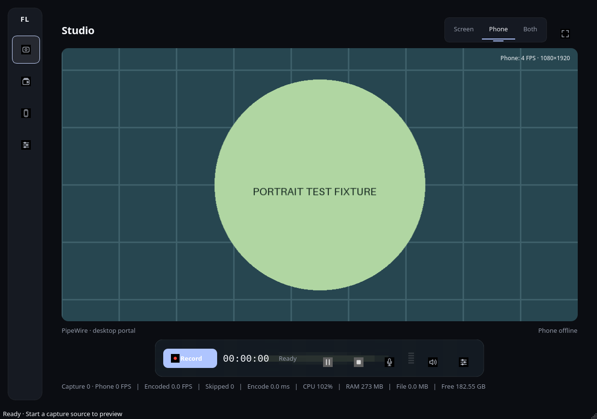
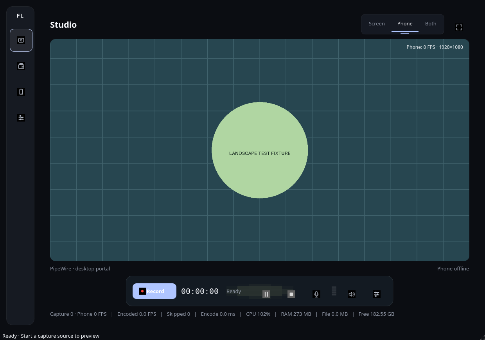

# Recording, certificate trust, camera quality and preview verification

This work modifies the existing FrameLink application. No release was published. Physical iPhone Safari, Android Chrome and current Windows execution remain unverified. Earlier CI evidence must not be treated as verification of these changes.

## Findings and fixes

### Stop

The Studio's main Record/Stop control was also referenced by `start_btn`. Each UI timer tick disabled `start_btn` whenever recording was active, disabling the user's Stop action. A second defect called the nonexistent `AudioBuffer.latest()` method during the same tick, raising an exception before the rest of the UI update. This was reproduced with a real QApplication: the visible Stop control was disabled, clicking it left the controller Recording, while calling the controller directly stopped it.

The controller now follows Ready → Preparing → Recording → Stopping → Finalizing recording → Completed, with separate Paused and Error states. Stop acknowledges immediately, freezes the recording clock, disables duplicate requests and is idempotent. Encoder initialization and disconnect-induced pause honor Stop. A worker flushes the encoder and muxer, fully decodes/validates streams, promotes files without overwriting existing files, and indexes the library before Completed. Automatic compression follows successful finalization. Stopping before the first frame produces an explicit cancellation error rather than a false completed recording. Failed and interrupted media is retained.

Qt owns UI operations; recording/validation runs on the recording worker, signaling runs on its asyncio thread, and compression runs independently. Stopping a recording intentionally leaves desktop/phone preview available. Disconnect stops camera transport. Neither waiting for a WebRTC shutdown nor a Qt/asyncio deadlock was needed to reproduce the reported Stop defect.

### Certificate trust

The stored local CA and the leaf served at the current Wi-Fi IP passed strict validation. This does **not** establish whether the reported iPhone installed and fully trusted that CA; the device was unavailable. Its precise trust-store state remains unknown.

Two application defects obscured diagnosis: leaf reuse checked issuer names without proving signature/key/chain validity, and `/verify` claimed Safari trusted the desktop merely because the page loaded. The latter is false after a user bypasses a warning. Reuse now verifies signature, matching private key, chain, SAN, EKU and dates. The persistent root is retained on restart and IP changes. The diagnostic makes a real strict TLS connection to the QR address and detects a stale listener serving a different leaf from the configured file.

Setup now offers public-only certificate/profile export to a separate transfer folder, shows the root SHA-256 fingerprint, explains explicit iOS full trust, warns that HTTP download cannot authenticate itself, and rejects exporting over the private identity directory. The desktop dialog displays the actual endpoint validation result asynchronously. No TLS validation bypass is used or recommended.

### Camera quality

The baseline browser granted 1920×1080 at 30 FPS, but WebRTC transmitted 640×360. Its sender target was about 0.414 Mbit/s and reported bandwidth limitation. The initial problem was after camera acquisition, before desktop decoding. Independently, the desktop phone preview was reduced to 640 pixels wide.

The browser now inspects capabilities and granted settings, initially requests 1080p/30 without mandatory dimensions, configures a resolution-aware bitrate ceiling and a maintain-resolution preference, and reports actual sender statistics. Congestion signals reduce the ceiling; recovery increases it. A low receive cadence alone does not prove network congestion. An optional Chromium startup hint must be applied to the remote answer; applying it to the local offer was experimentally ineffective. H.264 is preferred when advertised, with other codecs retained. Safari may ignore the optional hint; its behavior requires device testing.

Higher camera modes are probed only with advertised capability and measured network/receiver headroom, outside an active recording. Requested settings are never treated as granted settings. Unsupported sender parameters appear in diagnostics. No external bandwidth test or service is used.

Recording initially sustained only about 14 FPS on the detailed 1080p fixture, even while receiving 30 FPS. Native single-source recording now avoids an unnecessary RGB → Pillow → RGB round trip. Software capture uses H.264 CRF 20 with an ultrafast preset; this reduces CPU cost and makes larger originals. Export retains its independently selected compression settings. The phone preview uses received dimensions directly. The receive, preview and recording paths are measured separately.

### Preview

The old renderer always fitted the full image inside an inset rectangle, leaving bars for mismatched aspect ratios. The renderer now computes a centered source crop from actual frame dimensions and current Qt logical surface dimensions on every paint. Fill is the default; Fit and explicitly selected Stretch are available. The rounded surface is clipped without an inner padding strip. Resize, frame dimension changes and fullscreen use the same mapping; Qt applies display pixel scaling.

Preview policy does not change the source buffer or recorded dimensions. Combined-mode preview follows its output composition. A recording's dimensions remain fixed for that file; mid-recording camera orientation changes are fitted into that existing canvas. Native portrait starts are tested without padding. Physical phone rotation and browser orientation behavior still need the checks below.

## Measured media

Same moving 1920×1080/30 `testsrc2` Y4M camera fixture, Chromium 153.0.8010.12, real encrypted WebRTC over loopback. The browser trusted a temporary CA through an isolated NSS database; certificate verification remained enabled. These are synthetic-camera desktop measurements, not phone sensor quality or Wi-Fi benchmarks.

| Measurement | Before | After |
|---|---:|---:|
| Browser capture | 1920×1080 / 30 FPS | 1920×1080 / 30 FPS |
| Received video | 640×360 / 29.99 FPS | 1920×1080 / approximately 30 FPS |
| Sender target bitrate | 0.414 Mbit/s | 7.464 Mbit/s |
| Measured sender bitrate | Not sampled as a delta | 7.419 Mbit/s |
| Saved H.264/AAC | 640×360 | 1920×1080 |
| Nominal video FPS | 30 | 30 |
| Decoded frames / measured FPS | 66 / 29.75 | 66 / 28.92 |
| Validated duration | 2.2183 s | 2.2823 s |
| File size | 356,108 bytes | 4,408,965 bytes |
| FFprobe container bitrate | 1.283 Mbit/s | 15.423 Mbit/s |

After-change recording clock: 2.2506 seconds excluding pause. Two output frames were skipped; timing was preserved. Audio and video started at zero, and decoded end times passed the 300 ms validation tolerance. Short receiver windows can fluctuate slightly above/below 30 FPS due to arrival jitter. The larger original is an explicit speed/quality tradeoff, not a compression improvement.

The automated comparison requires identical source settings, matching source/received/saved dimensions, at least 24 received and decoded FPS, verified TLS, and duration agreement when the clock measurement is present. [Comparison JSON](verification/critical-fixes/camera-comparison.json), [camera FFprobe](verification/critical-fixes/camera-ffprobe.json).

Native Qt X11 capture under Xvfb produced H.264 at 1280×720: 5.1497 seconds, 300 decoded frames, 58.26 measured FPS (nominal 60), no audio. Stop finalized and indexed the recording. [Screen FFprobe](verification/critical-fixes/screen-ffprobe.json). This tests the real X11 API on a virtual display, not a physical Wayland or Windows display.

## Certificate validation result

A listener using the installed desktop identity served `the selected private LAN HTTPS address`. Strict OpenSSL-backed validation negotiated TLS 1.3 and passed chain/signature, exact IP SAN, server-authentication EKU and validity checks. The leaf SANs were the selected private LAN IP, `127.0.0.1`, and `localhost`; expiry was 2027-01-09 23:20:44 UTC. The root fingerprint persisted across reopening the identity. [Listener audit, with device identifiers redacted](verification/critical-fixes/installed-identity-tls.json).

That address is an observation from this machine, not a fixed connection address. Use the current QR address. No actual iPhone trust-store inspection or warning-free Safari session has been performed.

## Regression evidence

- Python/Qt/media/security suite: see `artifacts/critical-fixes/tests.xml` and the final run summary. Coverage includes actual Qt Stop clicks in Screen, Phone, Both PiP and Both separate, two sessions per mode, duplicate Stop, decoded files, automatic compression completion, connection loss, encoder failure and preparation cancellation.
- Portrait recording preserves native dimensions and correct mirroring. Preview geometry and real Qt paint coverage pass portrait/landscape/resizing tests, also repeated with `QT_SCALE_FACTOR=2` (11 tests).
- TLS tests cover persistent identity, public export, SAN/EKU/validity, mismatched private-key repair, strict actual-listener validation, stale listener detection, and the live diagnostic result in the Qt setup dialog.
- Node tests exercise sender bitrate initialization, congestion reduction, recovery, parameter errors and stopping diagnostics. Syntax checks pass for both mobile JavaScript files.
- Real Chromium integration covers trusted secure context, encrypted camera/audio reception, recording indication, pause/resume, camera reacquisition, reconnect, desktop disconnect, cancellation during acquisition and fresh QR reuse. There were no page errors. Saved media passed full decoding and FFprobe inspection.
- Release gate exits nonzero with unverified platform/device/distribution requirements; it requires every listed recording, quality, preview, TLS, transport, packaging and audit gate.

Actual Studio screenshots below use labelled orientation fixtures rather than a physical phone image. The circular reference remains circular and the preview surface is covered in both orientations.





## Reproducing checks

```sh
QT_QPA_PLATFORM=offscreen python -m pytest -q
QT_QPA_PLATFORM=offscreen QT_SCALE_FACTOR=2 python -m pytest -q tests/test_preview_scaling.py
node tests/camera_quality.cjs
node --check src/framelink/web/camera.js
node --check src/framelink/web/quality.js
python tools/preview_check.py

# Linux browser check requires Playwright Chromium, bubblewrap and NSS certutil.
ffmpeg -f lavfi -i testsrc2=size=1920x1080:rate=30 -t 5 -pix_fmt yuv420p camera.y4m
FRAMELINK_CAMERA_FIXTURE=camera.y4m FRAMELINK_BROWSER_OUTPUT=artifacts/camera-after python tools/browser_check.py
python tools/compare_camera.py artifacts/camera-before artifacts/camera-after --output artifacts/camera-comparison.json
python tools/release_gate.py docs/release-verification.json
```

The browser tool can serve the preserved pre-fix `camera.js` with `FRAMELINK_BASELINE_JS` for the before run. The original working-tree version is preserved locally at `artifacts/critical-fixes/camera-before.js`; use the same fixture for both runs. Private trust stores created by the browser test are temporary; host trust is not modified. Original before/after MKV files and raw reports remain under `artifacts/critical-fixes/`.

## Manual device verification

1. On an iPhone that has not bypassed this desktop's TLS warning, connect to the same LAN. Export the public trust material from FrameLink. Transfer it through a trusted physical path, such as Apple Configurator where available. Alternatively, use the temporary HTTP setup URL and compare the fingerprint of the downloaded certificate itself with the desktop. Do not trust the fingerprint text from HTTP alone. If the device cannot expose the fingerprint for comparison, use trusted transfer.
2. Install the profile in **Settings → Profile Downloaded**, or **Settings → General → VPN & Device Management**. Then open **Settings → General → About → Certificate Trust Settings** and enable full trust for the matching FrameLink root. Apple distinguishes profile installation from TLS trust in its [official instructions](https://support.apple.com/en-us/102390). Confirm the device date/time.
3. Run **Validate served certificate at QR address** on the desktop. Open `/verify` at that exact HTTPS address in a fresh Safari session. It must open without a warning or **Visit This Website**. A previously bypassed warning can invalidate this test; use a clean Safari/device state and record that condition. If it still warns, collect the current URL, installed root fingerprint and desktop audit result, checking for an old root, wrong IP/SAN, stale listener or bad clock. Do not send private keys.
4. Restart FrameLink. Confirm the root fingerprint is unchanged and Safari still opens without warning. Change the LAN IP, restart the listener and scan the new QR; the leaf should change while the trusted root remains unchanged.
5. Grant camera/microphone permission. Exercise rear/front cameras, portrait/landscape rotation, desktop resizing and fullscreen. Fill must cover the preview without distortion; Fit must show the entire image. Start a portrait recording and confirm its saved dimensions remain portrait. Note the fixed-canvas limitation when rotating during a file.
6. Record at least 30 seconds in Phone, Screen and Both, testing PiP and separate files. Press Stop repeatedly. It must immediately display Finalizing recording, then Completed only after validation; compression must run and the library must show playable files. Start a second session. Repeat with pause and with Wi-Fi loss under each selected disconnect policy.
7. Record capture settings and desktop receiver diagnostics during motion. Use `ffprobe -v error -show_streams -show_format -of json FILE` and full decoding to compare actual dimensions, FPS, codec, bitrate, duration and A/V alignment. Do not use nominal stream FPS as measured throughput. Test foregrounding, locking and reconnect; mobile background capture is not guaranteed.
8. Repeat with physical Android Chrome, Windows 10/11, the Wayland portal, and offline router/phone-hotspot/desktop-hotspot configurations. Rebuild and run platform packages for this revision before marking their gates verified.

## Files changed for these fixes

- Lifecycle and native recording: `src/framelink/media/model.py`, `recording/engine.py`, `ui/components.py`, `ui/window.py`, `app.py`.
- Trust and diagnostics: `security/certificates.py`, `networking/server.py`, `networking/interfaces.py`, `networking/ice.py`, `ui/window.py`, `web/trust.html`.
- Transport quality: `web/camera.js`, new `web/quality.js`, `web/index.html`, `networking/server.py`.
- Preview mapping: `ui/preview.py`, `ui/window.py`.
- Regressions: `tests/test_recording_stop.py`, `test_tls_identity.py`, `test_preview_scaling.py`, `test_camera_quality.py`, `test_offline_ice.py`, `camera_quality.cjs`, and state/endpoint expectations in `test_core.py`, `test_media.py`, `test_network.py`.
- Verification and release prevention: `tools/browser_check.py`, `compare_camera.py`, `preview_check.py`, `release_gate.py`, `.github/workflows/build.yml`, README and verification documentation/evidence.

Pre-existing working-tree edits were preserved. The source-only checks here do not certify newly packaged Windows/Linux artifacts or physical phone compatibility. The release manifest keeps those requirements unverified.

## Phone startup latency follow-up

The delayed-preview path is now measured across separate clocks instead of
being inferred from the phone's status badge. The browser records T0–T5 with
`performance.now()`. The desktop records T6 from inbound RTP statistics, T7
after PyAV/aiortc decodes the first frame, and T8 from the Qt `paintEvent`
presentation signal. Browser status remains **Connected · awaiting video**
until the desktop sends `video-received`; it becomes live only after receiver
confirmation. Qt sends `preview-ready` after the first frame is painted.

The root cause in the startup path was an acknowledgment/state gap rather than
an intentional wait for recording: the receiver was consuming video, but the
desktop status and phone status did not distinguish WebRTC connected from
decoded video and actual Qt presentation. Preview also shared the small phone
history buffer used by recording. The receiver now consumes immediately on the
WebRTC track event, publishes the same decoded frame to an independent
latest-frame preview buffer and timestamped recording buffer, and retains the
pairing session during temporary WebRTC reconnects. Optional camera permission
observation is bounded so a browser permission API cannot stall negotiation.

### Measured synthetic end-to-end run

Evidence: `artifacts/delay-verification/result.json` and its FFprobe report. Host:
Arch Linux/Wayland, isolated Chromium 153.0.8010.12, synthetic moving
1920×1080/30 Y4M camera over encrypted loopback WebRTC, Qt preview attached
before connection. This is not a physical iPhone measurement.

| Stage | Measured |
|---|---:|
| T0 → T1 page/permission | 44.5 ms |
| T1 → T2 getUserMedia | 196.9 ms |
| T2 → T3 offer | 78.5 ms |
| T3 → T4 answer | 155.4 ms |
| T4 → T5 ICE | 6.3 ms |
| T6 first RTP → T7 decode | 63.0 ms |
| T7 decode → T8 Qt paint | 85.0 ms |
| T6 first RTP → T8 displayed | 148.0 ms |

The browser-to-desktop absolute timestamps are intentionally kept in separate
clock domains and are not subtracted. Received video measured 1920×1080 at
29.92 FPS with 0 packet loss and approximately 6.28 Mbit/s receiver bitrate.
The saved recording was H.264/AAC, 1920×1080, nominal 30 FPS, 2.645 seconds,
66 decoded frames, measured 24.95 FPS, 4,208,760 bytes; FFprobe reported
2.654 seconds and 12.69 Mbit/s container bitrate. The sender retained
1920×1080/30 and a 7.464 Mbit/s maximum bitrate with no resolution downscale.

The full local regression suite now passes 118 tests, plus browser JavaScript
startup/quality checks, phone Record/Stop acknowledgement checks, and the synthetic encrypted WebRTC/Qt run. The run also
exercised repeated reconnection without a new QR/session, camera reacquisition,
recording, pause/resume, finalization, and FFprobe inspection.

This evidence does not verify an iPhone. Physical iPhone Safari still requires
a clean-device run with the public root installed and explicitly trusted at
**Settings → General → About → Certificate Trust Settings**, followed by a
warning-free fresh QR URL, portrait/landscape rotation, camera switching, and
temporary Wi-Fi interruption. The unresolved Safari trust issue remains a
separate release blocker; no warning bypass was used.

## Remote desktop recording controls

The phone page now exposes a Record/Stop control for the actual desktop
recorder. Commands travel over the already authenticated WebRTC data channel;
there is no unauthenticated HTTP recording endpoint. Each command includes a
version, unique id and desktop state revision. The desktop executes it on the
Qt thread, returns the result and current recorder snapshot, and caches a
completed command id so repeated taps cannot start or stop twice.

The phone changes to Stop only after the desktop confirms that the selected
FrameLink mode has entered Preparing/Recording. It displays the desktop mode,
the configured phone-disconnect policy and the elapsed recording time. Desktop
state heartbeats and immediate state-transition messages keep the phone and
desktop controls synchronized. A lost connection clears the phone's confirmed
state and disables the control; it never reports a successful recording based
only on a sent command.

The existing desktop disconnect policy remains authoritative. Screen-only
recording continues when the phone disconnects. Phone and Both recordings use
the selected Hide, Freeze, Pause or Stop policy. Stopping from the phone uses
the same finalization and automatic-compression path as the desktop Stop
button.

The phone recording path now intentionally prioritizes lecture capture over
live-preview latency. It uses the granted camera cadence instead of upclocking
30 FPS input to a 60 FPS output timeline, does not apply realtime skip/cadence
adaptation to phone-only recording, and drains the bounded timestamp buffer
through the requested Stop point before validation. The preview remains
latest-frame based and can lag briefly while an encoder catches up.

## Offline hotspot ICE follow-up

FrameLink uses `iceServers=[]` on both browser and aiortc, so offline streaming
does not require public STUN, TURN, DNS, or internet access. The server now
filters the SDP answer to the interface address used by the QR URL and rewrites
browser mDNS host candidates to the HTTP peer address only on non-loopback local
networks. This prevents a laptop with Wi-Fi, Docker, VPN, and hotspot
interfaces from advertising an unrelated address to the phone.

The server records local/remote host candidates, ICE gathering and connection
states, selected candidate pair, DTLS state, RTP counters, decoded frame
counters, and Qt preview confirmation. `PhoneServer.network_diagnostics()` also
reports the selected desktop interface and read-only firewall guidance. It
never includes pairing tokens or session secrets and never changes firewall
rules. On Windows it points to a narrow private-profile Defender Firewall UDP
rule; on Linux it reports the detected firewall backend and asks the user to
allow only the FrameLink TCP/UDP traffic on the active private interface.

Failed ICE cleanup closes the failed peer's tracks/tasks while retaining an
unexpired pairing session. The browser retries negotiation with the same
session and address and does not rotate QR or TLS identity. The phone remains
awaiting video until `video-received` and `preview-ready` acknowledgments.

Automated offline evidence covers candidate filtering for `172.20.10.x`-style
hotspot addresses, mDNS rewriting, selected-interface diagnostics, credential
redaction, failed-peer session retention, and encrypted synthetic host ICE.
The actual test host was on a private IPv4 Wi-Fi network, not an iPhone hotspot, so
physical iPhone Personal Hotspot, Android hotspot, and firewall-blocked UDP
acceptance remain unverified.
