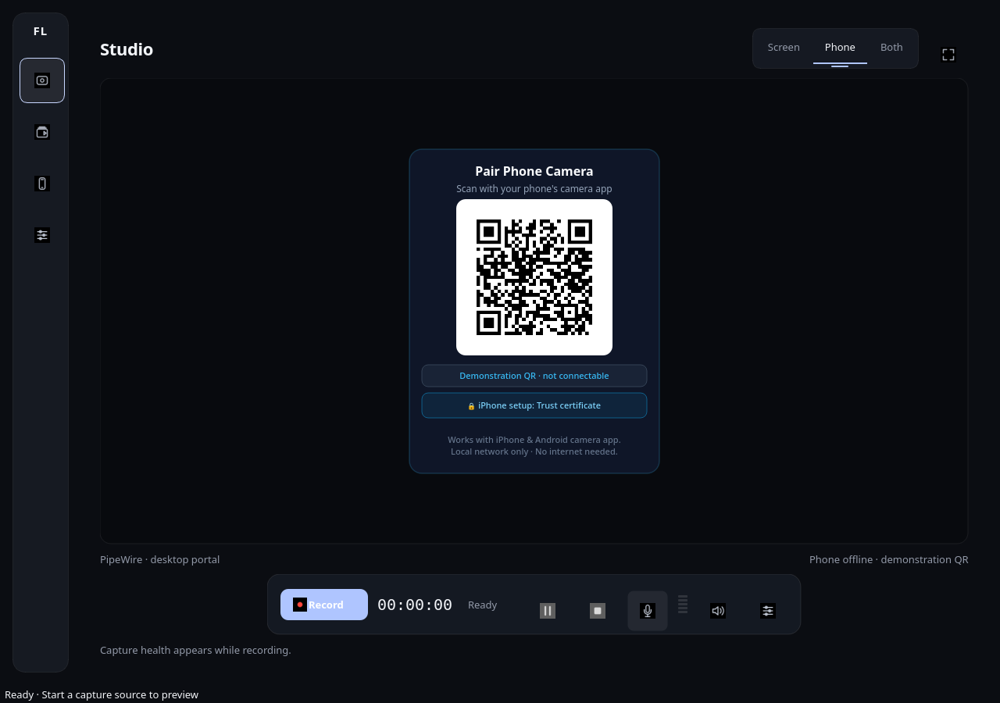
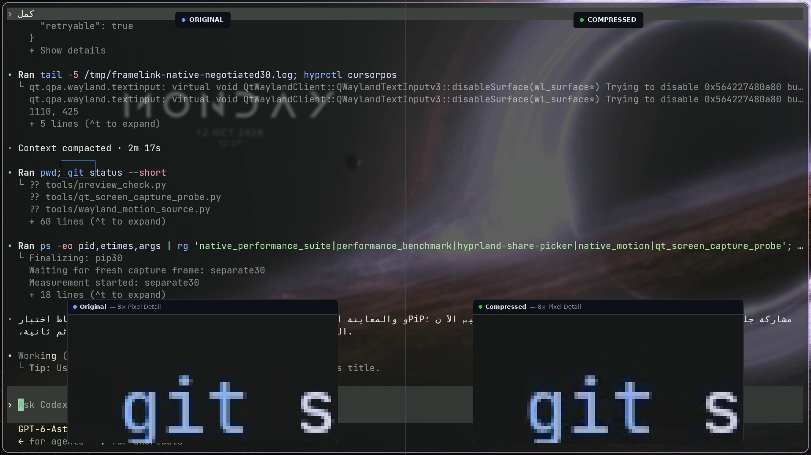

# FrameLink

通过本地网络录制桌面屏幕和手机摄像头。

[English](../../README.md) | [العربية](README.ar.md) | [Русский](README.ru.md) | [简体中文](README.zh-CN.md)

FrameLink 可以录制屏幕、手机摄像头，或同时录制两者。电脑通过加密的 WebRTC 连接接收手机浏览器的视频，将录像保存在本地，并自动排队导出 MP4、验证导出文件。无需云端账户。

*这是实际应用窗口。图中的二维码仅供展示，特意设置为无法连接；不包含配对凭据或私有网络地址。*

## 主要功能

- 使用 Windows 和 Linux 原生接口录屏，支持通过系统门户捕获 Wayland/Hyprland 屏幕。
- 通过 Android Chrome 和 iPhone Safari 传输摄像头视频；尚未完成实机验证。
- 同时录制屏幕和摄像头，支持画中画或分别保存时间同步的视频文件。
- 通过本地 Wi-Fi 配对，在手机端开始或停止录制，并录制麦克风音频。
- 自动压缩并验证导出文件；录制库显示文件大小和节省的空间。

## 压缩示例

**1.47 MB → 0.81 MB | 节省 45.2% 空间 | H.264**

一段时长 30 秒、分辨率为 1920×1080 的实际桌面录像在同一时间点（10.000 秒）的画面对比。8× 像素放大区域展示了精细文本保留情况及 DCT 编码特性。有损压缩效果取决于内容复杂度与设置。[文件、参数与比较方法](../COMPRESSION_EVIDENCE.md)。

对于今后的录像，**Keep Original（保留原始文件）**默认关闭：只有较小的导出文件通过完整性和抽样画质检查后，才会删除原始文件。已有录像受到保护。[保留策略](../COMPRESSION_RETENTION.md)。

## 安装

旧版 Windows 和 Linux 下载文件已撤下。请使用 Python 3.12 或更高版本，并按[源码安装说明](../USER_GUIDE.md#build-from-source)在 Windows 10/11 x64 或 Linux x86_64 上运行。Wayland 需要 PipeWire 和可用的 ScreenCast 门户。

新安装包将在设备验证和分发许可证检查通过后发布到 [Releases](https://github.com/Yousef-Jad/FrameLink/releases)。

## 三步上手

1. 启动 FrameLink，选择 **Screen**（屏幕）、**Phone**（手机）或 **Both**（两者）。
2. 使用 Phone 模式时，将两个设备连接到同一 Wi-Fi 或受支持的热点，完成 HTTPS 证书信任设置，再扫描配对二维码并授权摄像头访问。
3. 检查预览，开始录制，停止录制，然后在录制库中使用已通过验证的压缩文件。

## 无需互联网的配对

本地录制不需要互联网，但设备必须能通过本地地址相互访问，防火墙必须允许相关流量，手机也必须信任电脑的证书。启用客户端隔离的热点无法建立连接。

在 iPhone 上安装经过核验的公开根证书，再前往**设置 → 通用 → 关于本机 → 证书信任设置**启用完全信任。不要绕过 Safari 的证书警告。[证书信任与网络设置](../USER_GUIDE.md#first-time-certificate-trust-and-pairing)。

## 兼容性与验证状态

目标桌面平台为 Windows 10/11 x64 和 Linux x86_64。Linux X11 和 Hyprland/Wayland 原生录屏已有本地测试证据。Android/iPhone 实机视频传输与证书信任、Windows 客户端硬件、热点连接以及长时间音视频同步仍待验证。[验证证据与限制](../VERIFICATION.md)。

## 文档

- [安装、设置与故障排查](../USER_GUIDE.md)
- [架构](../ARCHITECTURE.md) · [性能](../PERFORMANCE.md)
- [安全](../../SECURITY.md) · [HTTPS 验证](../CRITICAL_FIXES.md)
- [开发与贡献](../../CONTRIBUTING.md)

## 许可证

[GPL-3.0-or-later](../../LICENSE)。各依赖项保留其自身许可证；详见[第三方声明](../../THIRD_PARTY_NOTICES.md)。
